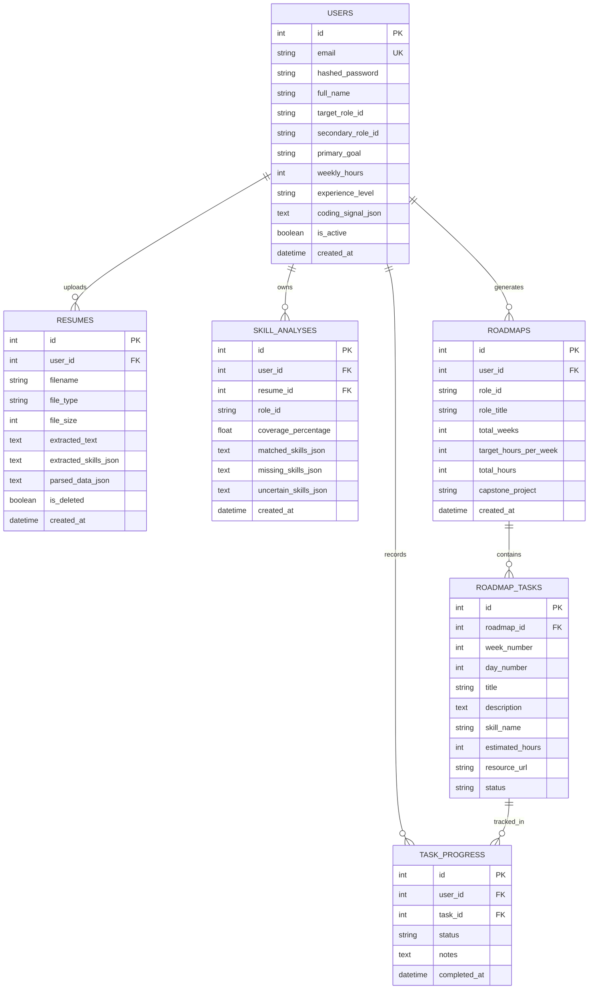

# SkillGraph System Architecture Specification

> **Document Version:** 2.0.0  
> **Status:** Implemented Production Architecture  
> **Live Production Deployment:** `https://skillgraph-q32n.onrender.com/frontend/index.html`  
> **Backend Framework:** Python 3.13 with FastAPI 0.115+  
> **Database:** SQLAlchemy 2.0 (SQLite with WAL mode / Cloud PostgreSQL via `DATABASE_URL`)  
> **Frontend:** Pure Semantic HTML5, CSS3 (Paper & Ink OKLCH Tokens), and Vanilla JavaScript (Zero Frameworks, No Bundlers)  
> **Extraction & Verification Engine:** Deterministic Regex with Word Boundaries, Jaccard Index, DAG Topological Sorting, GitHub REST & LeetCode GraphQL  

---

## 1. System Overview & Principles

SkillGraph is an account-based, evidence-driven career readiness platform. It quantifies the distance between a candidate’s verified technical capabilities (derived from resumes, code repositories, and self-assessments) and industry expectations (derived from curated role ontologies and parsed job postings).

```
                      ┌────────────────────────────────────────────────────────┐
                      │              BROWSER CLIENT (VANILLA JS)               │
                      │  HTML5 + CSS3 (Paper & Ink OKLCH) + Vanilla JS (ESM)   │
                      │  index.html, auth.html, dashboard.html, roles.html,    │
                      │  resume-review.html, coding.html, roadmap.html         │
                      └──────────────────────────┬─────────────────────────────┘
                                                 │ HTTP REST (JSON / Multipart)
                                                 ▼
                      ┌────────────────────────────────────────────────────────┐
                      │                 FASTAPI ASYNC BACKEND                  │
                      │  ASGI / Uvicorn  -  Pydantic v2  -  JWT HS256 Auth     │
                      └──────────────────────────┬─────────────────────────────┘
                                                 │
         ┌───────────────────────────────┬───────┴───────────────────────┬───────────────────────────────┐
         │                               │                               │                               │
         ▼                               ▼                               ▼                               ▼
┌──────────────────┐           ┌──────────────────┐            ┌──────────────────┐            ┌──────────────────┐
│  DATABASE LAYER  │           │ EXTRACTION / NLP │            │  ROADMAP / DAG   │            │  EXTERNAL APIS   │
│  SQLAlchemy 2.0  │           │ Deterministic    │            │ Prerequisite-    │            │ GitHub REST API  │
│  SQLite (WAL) or │           │ Regex with Word  │            │ ordered graph    │            │ LeetCode GraphQL │
│  Cloud Postgres  │           │ Lookarounds      │            │ 6-week curriculum│            │ 3-tier proof     │
└──────────────────┘           └──────────────────┘            └──────────────────┘            └──────────────────┘
```

### Architectural Principles

1. **Zero Frontend Framework Overhead:** The user interface is built strictly with standard HTML5, CSS3, and Vanilla JavaScript. No React, TypeScript, Vue, Svelte, or runtime bundling tools are used. Assets load instantaneously with zero build step.
2. **Strict Design System Preservation:** The "Paper & Ink" aesthetic (OKLCH color tokens, Fraunces display typography, Inter sans-serif, JetBrains Mono, warm parchment cards, subtle borders) is preserved across all pages.
3. **Stateless JWT Security & IDOR Protection:** Passwords are hashed with salted PBKDF2-HMAC-SHA256 (100,000 iterations). Authentication uses stateless HS256 JWT tokens. Every resource endpoint enforces strict User ID authorization matching `current_user.id`.
4. **Deterministic & Auditable Extraction:** Skill detection uses whole-word regex patterns with negative lookaheads and lookbehinds. This produces sub-5ms CPU execution, 100% reproducible results, zero token costs, and zero hallucinations.
5. **Transient Document Processing:** Resumes (PDF/DOCX) are parsed directly from memory streams. Binary files are never written to disk, preventing storage leaks and ensuring user privacy.
6. **Dual-Role Comparative Geometry:** Career comparison calculates set-theoretic overlap using the Jaccard similarity index and computes actionable bridge study hours.

---

## 2. Technology Stack & Specifications

| Layer | Technology | Version | Purpose & Rationale |
| :--- | :--- | :--- | :--- |
| **Frontend Runtime** | Pure Vanilla JavaScript | ES2022+ | Zero compilation required, zero dependency drift, maximum browser execution speed. |
| **Frontend Styling** | Native CSS3 + Custom Properties | CSS3 / OKLCH | Native design tokens, responsive CSS grid, flexbox, zero CSS-in-JS overhead. |
| **Frontend Charting** | Pure Vanilla SVG Renderers | Custom SVG | Replaces bulky charting libraries with lightweight, high-performance vector graphics. |
| **Backend Runtime** | Python | 3.13.7 | Modern typing syntax, high performance, robust data ecosystem. |
| **Web Framework** | FastAPI | 0.115+ | High-throughput asynchronous ASGI framework with automated OpenAPI & Swagger documentation. |
| **Data Validation** | Pydantic | v2.9+ | Fast Rust-backed schema validation, sanitization, and serialization. |
| **ORM / Data Layer** | SQLAlchemy | 2.0+ | Modern Pythonic ORM with mapped column typing, compatible with SQLite and PostgreSQL. |
| **Database Engine** | SQLite (WAL Mode) / PostgreSQL | 3.40+ / 16+ | Local development in WAL mode; Cloud PostgreSQL for permanent persistence on Render. |
| **Document Ingestion**| PyMuPDF (`fitz`) + `python-docx` | Latest | High-speed text extraction from PDF and DOCX streams without writing files to disk. |
| **Auth & Security** | `hashlib` (PBKDF2) + PyJWT | Latest | Cryptographically salted PBKDF2-HMAC-SHA256 password hashing and standard HS256 JWT tokens. |
| **External APIs** | `httpx` | 0.28+ | Async HTTP client for GitHub REST and LeetCode GraphQL queries. |

---

## 3. Frontend Architecture

### 3.1 Application Shell & Directory Structure

The frontend consists of discrete semantic HTML pages served as static files by FastAPI at `/frontend/`:

```
frontend/
├── index.html                   # Overview landing page with dynamic hero & navigation
├── auth.html                    # Dedicated Sign In & Account Registration page
├── dashboard.html               # Main dashboard with 6-domain taxonomy meters & SVG radar
├── resume-review.html           # Interactive resume skill review & chip editing interface
├── roles.html                   # Role catalogue with dual-role side-by-side comparison
├── coding.html                  # Coding profiles, GitHub repo analysis, LeetCode metrics
├── roadmap.html                 # 6-week curriculum with interactive progress checkboxes
├── css/
│   ├── variables.css            # OKLCH color tokens, typography scales, border radii
│   ├── style.css                # Global layout, typography, navigation, tag chips
│   ├── components.css           # Buttons, cards, modal dialogs, status badges
│   └── roadmap.css              # Curriculum timeline, milestone cards, task checkboxes
└── js/
    ├── config.js                # API base URL configuration
    ├── api.js                   # Authenticated HTTP client wrapper (handles JWT headers)
    ├── app.js                   # Route guarding, shared navigation, modal controller
    ├── auth.js                  # Login, registration, and onboarding calibration
    ├── dashboard.js             # Category analytics & SVG radar charts
    ├── resume-review.js         # Interactive skill chips editor (add/remove/save)
    ├── roles.js                 # Dual-role comparison & selection persistence
    ├── coding.js                # Project evidence & 3-tier proof badges
    └── roadmap.js               # 6-week DAG timeline & task status patcher
```

### 3.2 Client-Side Route Guarding (`app.js`)
Protected pages (`dashboard.html`, `roadmap.html`, `resume-review.html`, `coding.html`) check for a valid JWT token in `localStorage.getItem("skillgraph_token")`. If absent, the user is redirected to `auth.html?redirect=...` with a helpful notification toast.

### 3.3 Zero-Dependency SVG Radar & Progress Charting (`dashboard.js`)
Rather than pulling in heavy libraries (such as Chart.js or D3), custom mathematical functions render SVG radar polygons and taxonomy bars directly into the DOM using trigonometric polar transformations:
$$\theta_i = \frac{2\pi \cdot i}{N} - \frac{\pi}{2}, \quad x_i = c_x + r \cdot \frac{v_i}{100} \cdot \cos(\theta_i), \quad y_i = c_y + r \cdot \frac{v_i}{100} \cdot \sin(\theta_i)$$

---

## 4. Backend Architecture

### 4.1 Request-Response Lifecycle
1. **Client Call:** Vanilla JS issues `fetch()` with `Authorization: Bearer <jwt_token>`.
2. **ASGI Ingestion:** Uvicorn routes the request into FastAPI.
3. **CORS Validation:** `CORSMiddleware` checks the `Origin` header.
4. **Auth Dependency (`get_current_user`):** Decodes JWT, verifies signature with `SECRET_KEY`, queries the `User` from the database.
5. **Pydantic Validation:** Body parameters are validated against request schemas.
6. **Service Execution:** Business logic processes the request (`role_discovery.py`, `skill_analyzer.py`, etc.).
7. **ORM Persistence:** SQLAlchemy commits transactions atomically.
8. **Serialization:** Response schemas serialize the result into clean JSON.

---

## 5. Database Architecture & Data Models

SkillGraph uses **SQLAlchemy 2.0** mapped columns.



---

## 6. Algorithmic Deep Dive

### 6.1 Cryptographic Password Security & JWT
- **Algorithm:** PBKDF2 with HMAC-SHA256.
- **Salt:** 16 cryptographically secure random bytes per user.
- **Iterations:** 100,000 rounds.
- **Format:** `salt_hex$iterations$hash_hex` stored in `users.hashed_password`.
- **JWT:** Signed with HS256 containing `sub` (User ID) and `exp` claims.

### 6.2 Deterministic Regex Skill Extraction with Boundary Lookarounds
Regular expression boundary matching eliminates substring errors (e.g. detecting "Go" inside "Google" or "C" inside "CSS"):
$$\text{Pattern} = \text{(?<![a-zA-Z0-9\_])} + \text{escaped\_alias} + \text{(?![a-zA-Z0-9\_])}$$
- Each alias is mapped back to its canonical name in `backend/app/data/skill_aliases.json`.

### 6.3 Jaccard Similarity Index for Dual-Role Overlap
Used in `backend/app/services/role_discovery.py` to compare two career paths:
$$J(Role_A, Role_B) = \frac{|Role_A \cap Role_B|}{|Role_A \cup Role_B|}$$
- Computes shared foundational skills, unique role requirements, and bridge study hours based on missing core competencies.

### 6.4 Directed Acyclic Graph (DAG) Topological Sorting for Roadmaps
Roadmap tasks define prerequisite dependencies:
- Graph vertices $V$ = missing target skills.
- Graph edges $E$ = directed prerequisite dependencies $(u \to v)$ where $u$ must be learned before $v$.
- Topological sort ensures that foundational skills (e.g. Docker, Python) appear in early weeks (Weeks 1-2) before advanced orchestration and deep learning (Weeks 3-5), concluding with an integration capstone project in Week 6.
- Greedy bin-packing distributes tasks within the candidate's weekly study budget (e.g. 10 hours/week).

### 6.5 Multi-Signal Verification Algorithm
- GitHub REST API analyzes repositories, topics, and languages to find code evidence for resume claims.
- LeetCode GraphQL API extracts problem counts across Easy, Medium, and Hard categories.
- Skills are classified into 3 verifiable tiers:
  1. 🟢 **Verified Repo:** Confirmed in active public code repositories.
  2. 🟡 **Resume Mention:** Declared in resume text without code evidence.
  3. ⚪ **Needs Demonstration:** Required by target role but not yet detected.

---

## 7. Cloud Deployment & Production Configuration

- **Host:** Render Web Service (`https://skillgraph-q32n.onrender.com/frontend/index.html`).
- **Start Command:** `uvicorn app.main:app --host 0.0.0.0 --port $PORT`
- **Root Directory:** `backend`
- **Build Command:** `pip install -r requirements.txt`
- **Root Redirection:** `GET /` redirects web browsers (`Accept: text/html`) to `/frontend/index.html` while returning API metadata JSON to programmatic clients.
