# SkillGraph Architecture Specification

> **Document Version:** 1.0.0  
> **Status:** Architecture Blueprint  
> **Backend Framework:** Python 3.11+ with FastAPI  
> **Database:** SQLite with SQLAlchemy 2.0 (designed for frictionless PostgreSQL + pgvector migration)  
> **Frontend:** Pure Semantic HTML5, CSS3, and Vanilla JavaScript (ES Modules, Zero Frameworks)  
> **Machine Learning & NLP:** spaCy, Sentence Transformers (`all-MiniLM-L6-v2`), scikit-learn  

---

## 1. System Overview & Principles

SkillGraph is an evidence-based career readiness platform. It quantifies the semantic distance between a candidate’s verified technical capabilities (derived from resumes, code repositories, and self-assessments) and industry expectations (derived from curated role ontologies and parsed job postings).

```
                      +------------------------------------------------------+
                      |               BROWSER CLIENT (VANILLA)               |
                      |  HTML5 + CSS3 (Paper & Ink OKLCH) + Vanilla JS (ESM) |
                      |  Custom Vanilla Router + Custom Vanilla SVG Charts   |
                      +---------------------------+--------------------------+
                                                  | JSON / Multipart HTTP REST
                                                  v
                      +------------------------------------------------------+
                      |                FASTAPI ASYNC BACKEND                 |
                      |  ASGI / Uvicorn  -  Pydantic v2  -  JWT Auth         |
                      +---------------------------+--------------------------+
                                                  |
         +--------------------+-------------------+--------------------+
         |                    |                                        |
         v                    v                                        v
+------------------+ +-----------------------+               +------------------+
|  DATABASE LAYER  | |       NLP / ML ENGINE  |               |  EXTERNAL APIS   |
|  SQLAlchemy 2.0  | |  spaCy (NER / Ruler)  |               |  GitHub REST API |
|  SQLite (WAL)    | |  SentenceTransformers |               |  (Rate limited,  |
|  (Alembic Migr.) | |  Cosine Similarity    |               |   cached)        |
+------------------+ +-----------------------+               +------------------+
```

### Architectural Principles

1. **Zero Frontend Framework Overhead:** The user interface is built strictly with standard HTML5, CSS3, and Vanilla JavaScript ES Modules. No React, TypeScript, Vue, Svelte, or runtime bundling tools are used.
2. **Strict Design Preservation:** The exact visual hierarchy, "Paper & Ink" color palette (OKLCH tokens), Fraunces serif typography, and tactile component system are replicated faithfully.
3. **Decoupled API Contract:** The backend exposes a clean REST API matching the exact contract observed in the original client application, enabling seamless live operation alongside local demo fallbacks.
4. **Deterministic & Semantic Hybrid NLP:** Skill extraction combines deterministic pattern matching (spaCy EntityRuler for exact tech names like `FastAPI`, `pgvector`) with dense semantic vector representations (Sentence Transformers `all-MiniLM-L6-v2` for conceptual matching).
5. **Progressive Database Evolution:** Initial implementation utilizes SQLite in WAL (Write-Ahead Logging) mode with foreign keys enabled, cleanly abstracted via SQLAlchemy 2.0 to permit simple migration to PostgreSQL with `pgvector`.

---

## 2. Technology Stack

| Layer | Technology | Version | Rationale |
| :--- | :--- | :--- | :--- |
| **Frontend Runtime** | Pure Vanilla JavaScript (ESM) | ES2022+ | Zero compilation required, zero dependency drift, maximum browser speed. |
| **Frontend Styling** | Native CSS3 + Custom Properties | CSS3 / OKLCH | Native variables, responsive grid, flexbox, zero CSS-in-JS overhead. |
| **Frontend Charting** | Pure Vanilla SVG Renderers | Custom SVG | Replaces bulky charting libraries with lightweight, high-performance vector graphics. |
| **Backend Runtime** | Python | 3.11+ | High performance, native typing, standard NLP ecosystem. |
| **Web Framework** | FastAPI | 0.115+ | High-throughput asynchronous ASGI framework with automated OpenAPI docs. |
| **Data Validation** | Pydantic | v2.9+ | Fast Rust-backed schema validation and serialisation. |
| **ORM / Data Layer** | SQLAlchemy | 2.0+ (Async) | Modern Pythonic ORM with async engine support and clean migration path. |
| **Database Migrations**| Alembic | 1.14+ | Schema version control and automated migration scripts. |
| **Database Engine** | SQLite (WAL Mode) | 3.40+ | Serverless, zero-config initial database with full relational constraints. |
| **Document Ingestion**| `pdfplumber` + `python-docx` | Latest | Robust text and layout extraction from PDF, DOCX, and TXT files. |
| **NLP Pipeline** | `spaCy` (`en_core_web_sm`) | 3.8+ | Fast entity recognition, tokenization, lemmatization, and custom EntityRuler. |
| **Embedding Model** | `sentence-transformers` | 3.0+ | `all-MiniLM-L6-v2` (384-dimensional dense vectors, lightweight and CPU-friendly). |
| **Vector Math** | `scikit-learn` / `numpy` | 1.5+ | Cosine similarity matrix operations and statistical scoring. |
| **Auth & Security** | `passlib[bcrypt]` + `python-jose` | Latest | Secure salted password hashing and standard HS256 JWT tokens. |

---

## 3. Frontend Architecture (Vanilla JavaScript & CSS)

### 3.1 Application Shell & Directory Structure

The frontend is served as static files from the FastAPI `static/` directory or a standalone web server:

```
frontend/
├── index.html                   # Master single-page application entrypoint
├── css/
│   ├── variables.css            # OKLCH color tokens, typography scales, radii
│   ├── base.css                 # Reset, typography, layout scaffolding
│   ├── components.css           # Buttons, cards, pills, forms, timelines
│   └── utilities.css            # Responsive grids, spacing, keyframe animations
└── js/
    ├── app.js                   # Application bootstrap and router initialization
    ├── router.js                # Vanilla History API client-side router
    ├── state.js                 # Central reactive store & localStorage manager
    ├── api.js                   # REST client mirroring the original API contract
    ├── mock-data.js             # Fallback mock datasets for demo mode
    ├── components/              # Reusable DOM generator functions
    │   ├── header.js            # Sticky header with active pill and mobile menu
    │   ├── footer.js            # Footer with ink underline links
    │   ├── primitives.js        # Card, Button, PageHeader, StatCard, SourceBadge
    │   └── toast.js             # Toast notifications and error alerts
    ├── charts/                  # Zero-dependency vanilla SVG chart builders
    │   ├── area-chart.js        # Smooth monotone area chart with gradient fill
    │   ├── radar-chart.js       # 6-axis spider/radar chart
    │   ├── bar-chart.js         # Horizontal & vertical bar charts with rounded caps
    │   ├── donut-chart.js       # Language mix donut chart with legend pills
    │   └── line-chart.js        # Multi-point trend chart with dots
    └── views/                   # Page view renderers
        ├── landing.js           # / (Hero, principle, feature grid, dark CTA)
        ├── auth.js              # /auth (Split view, signin/signup tabs)
        ├── dashboard.js         # /dashboard (KPIs, trajectory, radar, target roles)
        ├── resume.js            # /resume (File drop zone, pipeline, extracted skills)
        ├── skills.js            # /skills (Role pills, readiness, present & missing)
        ├── github.js            # /github (Username form, cadence, languages, signals)
        ├── jobs.js              # /jobs (JD textarea, overall score, area breakdown)
        ├── roadmap.js           # /roadmap (Goal generator, progress bar, 6-week timeline)
        ├── analytics.js         # /analytics (Trend charts, top skills, activity log)
        └── projects.js          # /projects (Project cards, difficulty badges, hours)
```

### 3.2 Client-Side Router (`router.js`)

A lightweight router (~60 lines of vanilla JavaScript) manages navigation without page reloads using the browser History API:
* Listens to `popstate` events.
* Intercepts relative anchor clicks (`a[href^="/"]`).
* Matches path routes against registered view controllers (`/`, `/dashboard`, `/resume`, etc.).
* Dynamically executes the view mount function, updates `document.title`, and re-renders the active navigation pill in the sticky header.
* Supports route-guarding (redirecting to `/auth` if private data is required and no token/demo state exists).

### 3.3 State Management & Dual-Mode Engine (`state.js` & `api.js`)

* **Token Storage:** Stores JWT auth token in `localStorage.getItem('sg_token')`.
* **Dual-Mode Detection:**
  * Checks backend connectivity via `GET /health` or `GET /skills/`.
  * If backend is reachable: operates in **Live Mode** (`source: 'live'`).
  * If backend is unreachable or unconfigured: seamlessly operates in **Demo Mode** (`source: 'demo'`), serving mock data from `mock-data.js` so all interactions (role switching, roadmap task toggling, JD scoring) work offline.
* **Reactive Re-rendering:** When an async API call returns, the active view's specific DOM section is updated in place without full page refreshes.

### 3.4 Custom Vanilla SVG Charting Engine

Rather than bundling heavy third-party charting libraries, vanilla SVG renderers generate mathematical vector graphics directly:
* **Area Chart (`area-chart.js`):** Calculates Bézier cubic curve control points through coordinates `(x_i, y_i)`, closes the SVG path along the X-axis baseline, and applies `<linearGradient id="g">` with `<stop stop-color="var(--ink)" stop-opacity="0.35"/>`.
* **Radar Chart (`radar-chart.js`):** Computes polygon vertices using polar coordinate transformations:
  $$\theta_i = \frac{2\pi \cdot i}{N} - \frac{\pi}{2}, \quad x_i = c_x + r \cdot \frac{v_i}{100} \cdot \cos(\theta_i), \quad y_i = c_y + r \cdot \frac{v_i}{100} \cdot \sin(\theta_i)$$
  Renders concentric polygon grid webs and two overlaid polygon paths ("You" and "Target").
* **Donut Chart (`donut-chart.js`):** Computes arc paths with `SVGPathElement` `M ... A ...` using trigonometric coordinates, maintaining `innerRadius: 55` and `outerRadius: 95`.
* **Bar Charts (`bar-chart.js`):** Renders SVG `<rect>` elements with `rx="999"` for pill caps.

---

## 4. Backend Architecture (Python & FastAPI)

### 4.1 Application Directory Structure

```
backend/
├── app/
│   ├── __init__.py
│   ├── main.py                  # FastAPI application entrypoint & middleware
│   ├── config.py                # Environment settings via Pydantic BaseSettings
│   ├── database.py              # SQLAlchemy async engine, sessionmaker, Base
│   ├── models/                  # SQLAlchemy ORM entity definitions
│   │   ├── __init__.py
│   │   ├── user.py              # User account & credential models
│   │   ├── skill.py             # Skill ontology & candidate skill assessments
│   │   ├── role.py              # Target role definitions & skill requirements
│   │   ├── roadmap.py           # 6-week roadmap & checklist tasks
│   │   ├── job_match.py         # Stored JD comparisons & match breakdowns
│   │   └── activity.py          # Timeline audit events
│   ├── schemas/                 # Pydantic v2 validation models
│   │   ├── auth.py              # Signup, login, JWT token payloads
│   │   ├── skill.py             # Skill list, skill gap request/response
│   │   ├── resume.py            # Resume upload response schemas
│   │   ├── job.py               # JD match request and area breakdowns
│   │   ├── roadmap.py           # Roadmap generation and patch schemas
│   │   ├── github.py            # GitHub analysis schemas
│   │   └── analytics.py         # Summary metrics and activity log schemas
│   ├── routers/                 # FastAPI API route controllers
│   │   ├── auth.py              # /auth/signup, /auth/login
│   │   ├── resume.py            # /resume/upload
│   │   ├── skills.py            # /skills/, /skills/gap
│   │   ├── github.py            # /github/analyze
│   │   ├── jobs.py              # /jobs/match
│   │   ├── roadmap.py           # /roadmap/, /roadmap/{id}, /roadmap/generate
│   │   ├── analytics.py         # /analytics/summary, /analytics/activity
│   │   └── projects.py          # /projects/
│   ├── services/                # Core business logic & domain services
│   │   ├── auth_service.py      # Password hashing, JWT creation & verification
│   │   ├── parser_service.py    # Document text extraction (pdfplumber, docx)
│   │   ├── nlp_service.py       # spaCy NER + Sentence Transformers embedding
│   │   ├── gap_service.py       # Skill gap scoring & readiness calculation
│   │   ├── matcher_service.py   # Job description breakdown & keyword extractor
│   │   ├── roadmap_service.py   # Dynamic 6-week curriculum generator
│   │   └── github_service.py    # GitHub REST API client & cadence aggregator
│   └── seed/                    # Initial database fixtures & technology ontology
│       ├── ontology.json        # Curated tech taxonomy & role benchmarks
│       └── seed_data.py         # Database seeding script
├── migrations/                  # Alembic database migrations
│   ├── env.py
│   └── versions/
├── requirements.txt             # Python dependencies
└── tests/                       # Pytest automated test suite
```

---

## 5. Database Architecture & Data Models

### 5.1 Database Engine Configuration

* **Engine:** SQLite 3 with Write-Ahead Logging (`PRAGMA journal_mode=WAL;`).
* **Foreign Keys:** Enforced via SQLite connection listener (`PRAGMA foreign_keys=ON;`).
* **Connection Pooling:** SQLAlchemy `NullPool` (for SQLite) or `StaticPool` during tests.
* **Migration Compatibility:** All primary keys utilize standard UUID strings or BigInteger, ensuring zero schema modification when targeting PostgreSQL.

### 5.2 Entity Relationship Diagram (ERD)

```mermaid
erDiagram
    USER ||--o{ USER_SKILL : possesses
    USER ||--o{ ROADMAP_TASK : owns
    USER ||--o{ JOB_MATCH : performs
    USER ||--o{ GITHUB_PROFILE : connects
    USER ||--o{ ACTIVITY_LOG : logs

    SKILL ||--o{ USER_SKILL : assessed_in
    SKILL ||--o{ ROLE_SKILL : required_by

    ROLE ||--o{ ROLE_SKILL : defines
    ROLE ||--o{ JOB_MATCH : targets

    USER {
        string id PK "UUID"
        string email UK "Unique lowercase"
        string hashed_password "Bcrypt hash"
        string full_name "Optional"
        datetime created_at
        datetime updated_at
    }

    SKILL {
        string id PK "slug: e.g. 'fastapi'"
        string name "Display name: 'FastAPI'"
        string category "Backend, Frontend, ML, etc."
        boolean trending "Default false"
    }

    USER_SKILL {
        string id PK "UUID"
        string user_id FK
        string skill_id FK
        integer level "0-100 proficiency"
        string source "resume, manual, github"
        datetime detected_at
    }

    ROLE {
        string id PK "slug: e.g. 'ml-engineer'"
        string title "ML Engineer"
        text description
    }

    ROLE_SKILL {
        string id PK "UUID"
        string role_id FK
        string skill_id FK
        integer target_level "0-100 target"
        integer weight "1-5 importance weight"
        boolean is_critical "Required vs optional"
    }

    ROADMAP_TASK {
        string id PK "UUID"
        string user_id FK
        integer week "1 through 6"
        string focus "Week theme"
        string item "Actionable description"
        boolean done "Checklist status"
        datetime completed_at
    }

    JOB_MATCH {
        string id PK "UUID"
        string user_id FK
        string role_title "Extracted or assigned title"
        integer overall_score "0-100"
        json area_breakdown "List of {area, score}"
        json matched_skills "List of skill strings"
        json missing_skills "List of skill strings"
        text raw_jd "Original job description"
        datetime created_at
    }

    GITHUB_PROFILE {
        string id PK "UUID"
        string user_id FK
        string username UK
        integer repos
        integer stars
        integer followers
        integer commits_year
        json top_languages "List of {name, pct}"
        json activity_cadence "List of 26 weekly commits"
        datetime last_synced
    }

    ACTIVITY_LOG {
        string id PK "UUID"
        string user_id FK
        string event_type "resume_parse, job_match, etc."
        string title "Action summary"
        string detail "Extra delta info"
        datetime created_at
    }
```



---

## 6. Machine Learning & NLP Pipelines

### 6.1 Resume Ingestion & Skill Extraction Pipeline

The resume ingestion service processes incoming documents through a 4-stage pipeline matching the pipeline documented in the UI reference:

```
[Uploaded File] (.pdf, .docx, .txt)
       │
       ▼
[01. Text Extraction]
  ├── pdfplumber: Layout-aware extraction, table bounding, text blocks
  └── python-docx: Paragraph and table runs
       │
       ▼
[02. Preprocessing & NER]
  ├── Regex sanitisation & Unicode normalization
  └── spaCy Pipeline ('en_core_web_sm')
        └── EntityRuler: Curated taxonomy of 500+ technical terms,
            frameworks, libraries, databases, and DevOps tools
       │
       ▼
[03. Semantic Embedding]
  ├── Sentence Transformers ('all-MiniLM-L6-v2')
  └── Generates 384-dimensional dense vectors for resume phrases & project bullets
       │
       ▼
[04. Skill Scoring & Categorization]
  ├── Cosine similarity against Skill Ontology vectors
  ├── Frequency & context weighting (titles, duration, achievements)
  └── Returns: List of { name, level (0-100), category }
```

### 6.2 Technology-Role Ontology & Gap Analysis Algorithm

1. **Role Target Profile:** Each target role $R$ defines a set of required skills $S_R$ with target proficiency $T_s \in [0, 100]$ and importance weights $w_s \in [1, 5]$.
2. **Candidate Profile:** Candidate evaluated skills $S_C$ provide assessed proficiency $C_s \in [0, 100]$.
3. **Readiness Score Formulation:**
   $$\text{Readiness}(R) = \frac{\sum_{s \in S_R} w_s \cdot \min\left(1.0, \frac{C_s}{T_s}\right)}{\sum_{s \in S_R} w_s} \times 100$$
   * If a skill is missing entirely ($C_s = 0$), it contributes $0$ to the numerator and is classified as **Missing**.
   * Missing skills are ranked in order of their impact factor $I_s = w_s \times T_s$.
4. **Radar Vector Aggregation:** Skills are grouped into 6 core domains:
   * `Frontend`, `Backend`, `ML`, `DevOps`, `System Design`, `Testing`
   * Computes the mean candidate score vs. mean target role benchmark for each domain.

### 6.3 Job Description Matching Engine

1. **Document Ingestion:** The raw job description text is passed to `POST /jobs/match`.
2. **Entity & Concept Extraction:** The NLP pipeline extracts technical requirements, years of experience, and responsibilities.
3. **5-Area Decomposition:** The matcher evaluates semantic coverage across 5 standard engineering pillars:
   1. `Core language` (e.g. Python, Go, Rust, Java, TypeScript)
   2. `Frameworks` (e.g. FastAPI, Django, React, Next.js)
   3. `Data stores` (e.g. PostgreSQL, Redis, Elasticsearch, Kafka)
   4. `Infra / DevOps` (e.g. Docker, Kubernetes, CI/CD, AWS, Terraform)
   5. `System design` (e.g. Microservices, REST, gRPC, Caching, Scaling)
4. **Output:** Computes overall weighted alignment (0–100%), area breakdown percentages, matched skills list, and missing critical requirements.

### 6.4 Dynamic 6-Week Roadmap Generator

* Input: Identified skill gaps for the target role, sorted by priority $I_s$.
* Algorithm: Maps gaps into a pedagogical 6-week progression curve:
  * **Week 1 (Foundations):** Core language idioms, typing, tooling, linter setup.
  * **Week 2 (Data Layer):** Persistence, ORMs, schema migrations, query performance.
  * **Week 3 (Core Services / ML):** Business logic, algorithms, embeddings, pipelines.
  * **Week 4 (APIs & Security):** API contracts, JWT authentication, rate limiting, caching.
  * **Week 5 (Infra & DevOps):** Containerization, CI/CD automation, cloud deployment.
  * **Week 6 (Polish & Evidence):** Load testing, observability, case study / portfolio documentation.
* Tasks are stored in the database as interactive checklist items with individual IDs for state persistence.

---

## 7. API Architecture & Request/Response Contracts

The FastAPI backend implements the exact REST contracts expected by the frontend client:

### 7.1 Authentication Endpoints

* **`POST /api/auth/register`** (Alias: `POST /auth/signup`)
  * Request: `{ "email": "user@example.com", "password": "...", "full_name": "Jane Doe" }`
  * Response: `{ "access_token": "...", "token": "...", "token_type": "bearer", "expires_in_minutes": 30, "user": { "id": 1, "email": "...", "full_name": "..." } }`
* **`POST /api/auth/login`** (Alias: `POST /auth/login`)
  * Request: `{ "email": "user@example.com", "password": "..." }`
  * Response: `{ "access_token": "...", "token": "...", "token_type": "bearer", "expires_in_minutes": 30, "user": { ... } }`
* **`GET /api/auth/me`** (Alias: `GET /auth/me`)
  * Headers: `Authorization: Bearer <token>`
  * Response: `{ "id": 1, "email": "user@example.com", "full_name": "Jane Doe", "is_active": true, "created_at": "..." }`

### 7.2 Resume Parsing & Records

* **`POST /api/resume/parse`** (Alias: `POST /resume/upload`)
  * Content-Type: `multipart/form-data`
  * Request: `file: UploadFile` (PDF or DOCX up to 5MB)
  * Headers: `Authorization: Bearer <token>` (optional; persists record if authenticated)
  * Response:
    ```json
    {
      "success": true,
      "message": "Resume parsed successfully.",
      "text": "...",
      "metadata": {
        "filename": "resume.pdf",
        "file_type": "pdf",
        "file_size_bytes": 10240,
        "word_count": 450,
        "character_count": 2800,
        "requires_ocr": false,
        "is_empty_or_whitespace": false
      }
    }
    ```
* **`GET /api/resume/records`**: List active resume records for the authenticated user.
* **`GET /api/resume/records/{record_id}`**: Retrieve specific resume record with strict ownership checks (IDOR protected).
* **`DELETE /api/resume/records/{record_id}`**: Delete a resume record owned by the authenticated user.

### 7.3 Skills & Gap Analysis

* **`POST /api/skills/analyze`**
  * Request: `{ "text": "Extracted resume plain text...", "role_id": "harness-engineer" }`
  * Headers: `Authorization: Bearer <token>` (optional; persists analysis if authenticated)
  * Response: `AnalysisResult` (matched skills, missing skills, uncertain skills, priority gaps, coverage percentage).
* **`GET /api/skills/analyses`**: List past skill-gap analyses for the authenticated user.
* **`GET /api/skills/analyses/{analysis_id}`**: Retrieve specific analysis with strict ownership verification.
* **`DELETE /api/skills/analyses/{analysis_id}`**: Delete specific analysis owned by the user.
* **`GET /skills/`** and **`GET /skills/gap?role={role}`**: Backward-compatibility endpoints.

### 7.4 Job Description Matching

* **`POST /api/job-descriptions/analyze`** (Alias: `POST /jobs/match`)
  * Request: `{ "resume_text": "...", "job_description_text": "..." }`
  * Headers: `Authorization: Bearer <token>` (optional; persists analysis if authenticated)
  * Response: `JobDescriptionAnalysisResult` (extracted skills, matched skills, missing skills, required vs preferred, experience requirements, coverage percentage).
* **`GET /api/job-descriptions/analyses`**: List user's job description comparisons.
* **`GET /api/job-descriptions/analyses/{analysis_id}`**: Retrieve specific job description analysis with ownership check.
* **`DELETE /api/job-descriptions/analyses/{analysis_id}`**: Delete specific job description analysis.

### 7.5 Roadmap & Progress Tracking

* **`POST /api/roadmaps/generate`** (Alias: `POST /roadmap/generate`)
  * Request: `{ "role_id": "harness-engineer", "existing_skills": [], "weekly_hours": 10, "resume_text": "..." }`
  * Headers: `Authorization: Bearer <token>` (optional; persists roadmap, tasks, and initial progress if authenticated)
  * Response: `Roadmap` (6-week plan, ordered tasks with prerequisites and validated learning resources, capstone project).
* **`GET /api/roadmaps`**: List user's generated roadmaps with completion stats.
* **`GET /api/roadmaps/{roadmap_id}`**: Retrieve roadmap detail and tasks (strict ownership check).
* **`DELETE /api/roadmaps/{roadmap_id}`**: Delete roadmap and cascading tasks.
* **`PATCH /api/roadmaps/{roadmap_id}/tasks/{task_id}`** (Alias: `PATCH /roadmap/{task_id}`):
  * Request: `{ "status": "completed" }` or `{ "done": true }` or query parameter `?done=true`
  * Enforces ownership check: verifies the task belongs to a roadmap owned by the authenticated caller.
  * Updates task status and updates/creates user's `TaskProgressRecord`.
* **`GET /api/progress`**:
  * Response: `ProgressSummaryResponse` with total tasks, completed, in-progress, pending, completion percentage, and active roadmap tasks list.

### 7.6 Role Discovery & Evidence-Aware Market Insights

* **`GET /api/roles/`**:
  * Query parameters: `family`, `level`, `maturity` (`established` | `emerging`), `q` (free-text search).
  * Returns complete catalog of 11 roles with maturity classification and highlighted core skills.
* **`GET /api/roles/compare?role_a={id}&role_b={id}`**:
  * Bidirectional skill overlap calculation, Jaccard similarity percentage, shared core competencies, unique specializations, and transition bridge skills with estimated study hours.
* **`GET /api/roles/{role_id}`**:
  * Comprehensive profile including responsibilities, prerequisites, enriched core and optional skills, milestone projects, emerging discipline context, accessibility guidance, related roles, and market summary.
* **`GET /api/roles/{role_id}/related?top_n={n}`**:
  * Ranked related role suggestions based on composite Jaccard skill overlap.
* **`GET /api/roles/{role_id}/market-summary`**:
  * Evidence-aware market summary carrying documented provenance (source, collection date, geography, sample size) for verified roles, or transparent curated guidance disclaimers for unverified roles. Never generates fake statistics or synthetic salaries.

### 7.7 GitHub Analysis

* **`GET /github/analyze?username={username}`**
  * Response:
    ```json
    {
      "username": "candidate",
      "repos": 42,
      "stars": 318,
      "followers": 74,
      "commitsYear": 1284,
      "topLanguages": [
        { "name": "Python", "pct": 41 },
        { "name": "TypeScript", "pct": 28 },
        { "name": "Go", "pct": 12 }
      ],
      "activity": [
        { "week": "W1", "commits": 14 },
        { "week": "W2", "commits": 22 }
      ]
    }
    ```

---

## 8. Security & Authentication Architecture

* **Authentication Protocol:** OAuth2 Password Bearer flow issuing Signed JSON Web Tokens (JWT).
* **Cryptographic Standards:** Passwords hashed with `bcrypt` (12 rounds of salt). Tokens signed using HMAC-SHA256 (`HS256`) with a cryptographically secure server secret.
* **Token Expiration:** 7-day default validity window.
* **CORS Policy:** Strict origin whitelisting configured in FastAPI middleware:
  * Allowed origins: `http://localhost:8000`, `http://127.0.0.1:8000`, `https://career-ready-trail.lovable.app`.
* **Rate Limiting:** IP and user-based throttling on computationally intensive endpoints (`/resume/upload`, `/jobs/match`, `/github/analyze`).
* **Data Sanitisation:** File uploads inspected for MIME types (`application/pdf`, `application/vnd.openxmlformats-officedocument.wordprocessingml.document`, `text/plain`), maximum size capped at 5MB, and processed in isolated memory buffers.

