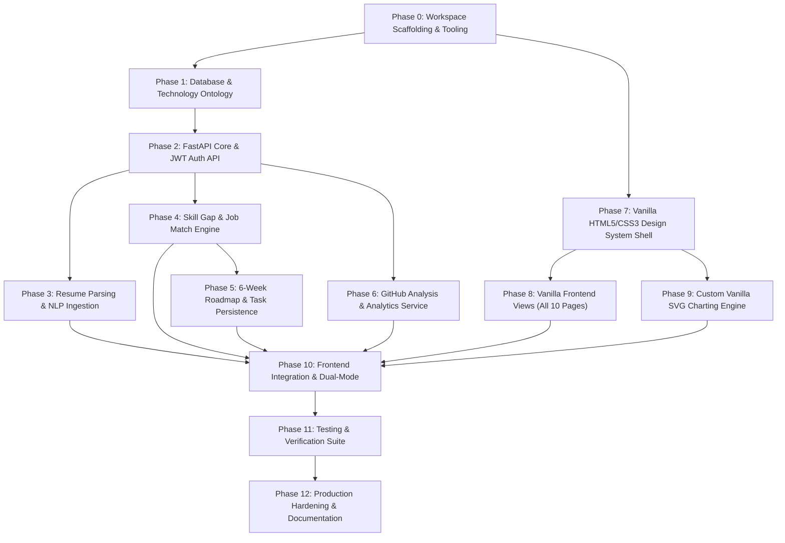

# SkillGraph Implementation Plan

> **Document Version:** 1.0.0  
> **Target Architecture:** Pure Vanilla HTML5/CSS3/JavaScript Frontend + Python FastAPI Backend + SQLite/SQLAlchemy Database  
> **Status:** Implementation Blueprint (Ready for Phase-by-Phase Execution)  

---

## 1. Executive Summary & Principles

This implementation plan outlines the complete engineering sequence to rebuild SkillGraph as a high-performance full-stack web application.

### Key Tenets
1. **Zero Frontend Frameworks:** Built strictly with semantic HTML5, modern CSS3 (OKLCH color system, CSS Grid/Flexbox), and Vanilla JavaScript (ES Modules). No React, Next.js, TypeScript, Vue, or build-step dependencies.
2. **Faithful Visual Replication:** The visual hierarchy, "Paper & Ink" theme, Fraunces serif typography, and tactile UI tokens from `https://career-ready-trail.lovable.app/` are preserved with 100% fidelity.
3. **Robust Python Backend:** Asynchronous FastAPI backend providing data persistence via SQLAlchemy 2.0 and SQLite (in WAL mode), engineered for zero-friction migration to PostgreSQL with `pgvector`.
4. **Evidence-Based NLP:** Dual-engine skill analysis combining exact deterministic pattern matching (spaCy EntityRuler) with dense vector semantics (Sentence Transformers `all-MiniLM-L6-v2`).
5. **Dual-Mode Operation:** The client operates in **Live Mode** when connected to the FastAPI backend and gracefully falls back to **Demo Mode** if offline, providing a resilient demonstration experience.

---

## 2. Complete Development Sequence

The development lifecycle is divided into 12 distinct, sequential phases with verified dependency gates.

---

### Phase 0: Workspace Scaffolding & Tooling Setup
* **Objective:** Establish the clean monorepo folder layout, Python virtual environment, dependencies, and static web server.
* **Deliverables:**
  * Root folder structure: `backend/`, `frontend/`, `docs/`, `tests/`.
  * `backend/requirements.txt`: FastAPI, Uvicorn, SQLAlchemy, Alembic, Pydantic, python-jose, passlib, bcrypt, pdfplumber, python-docx, spacy, sentence-transformers, scikit-learn, httpx, pytest.
  * Static file hosting configuration in FastAPI so `frontend/` is served directly at `/` while `/api` or root endpoints power the REST service.
* **Gate Check:** `python -m uvicorn backend.app.main:app` boots cleanly and serves a static health probe.

---

### Phase 1: Database Architecture & Technology-Role Ontology
* **Objective:** Configure SQLite in WAL mode with SQLAlchemy 2.0 async ORM and seed the expanded technology-role database.
* **Deliverables:**
  * `backend/app/database.py`: Async engine, sessionmaker, SQLite WAL & foreign key event hooks.
  * `backend/app/models/`: `User`, `Skill`, `Role`, `RoleSkill`, `UserSkill`, `JobMatch`, `RoadmapTask`, `GitHubProfile`, `ActivityLog`.
  * Alembic migration environment: `migrations/env.py` and initial migration `001_initial_schema.py`.
  * Curated Ontology Fixture (`backend/app/seed/ontology.json`):
    * 500+ technical skills categorized into 8 domains: `Languages`, `Frontend`, `Backend`, `Data/Databases`, `ML/AI`, `DevOps/Cloud`, `System Design`, `Testing`.
    * 12 industry engineering roles with target proficiency baselines (e.g., `ML Engineer`, `Full-Stack Engineer`, `AI Product Engineer`, `Backend Engineer`, `DevOps/SRE`, `Data Engineer`).
  * Seeding CLI script: `python -m backend.app.seed.seed_data`.
* **Gate Check:** Database seeds cleanly with relational integrity verified via pytest.

---

### Phase 2: FastAPI Core & Authentication Service
* **Objective:** Build robust user management and JWT security.
* **Deliverables:**
  * `backend/app/services/auth_service.py`: Bcrypt password hashing, JWT token creation, decode and validation.
  * `backend/app/schemas/auth.py`: Pydantic models for `UserSignup`, `UserLogin`, `TokenResponse`.
  * `backend/app/routers/auth.py`:
    * `POST /auth/signup` -> Returns JWT token and user record.
    * `POST /auth/login` -> Authenticates credentials and returns JWT token.
    * `GET /auth/me` -> Retrieves authenticated user profile.
  * Authentication dependency `get_current_user` injecting authenticated user into protected endpoints.
* **Gate Check:** Automated pytest suite verifying registration, duplicate email rejection, invalid password rejection, and token issuance.

---

### Phase 3: Resume Parsing & NLP Ingestion Engine
* **Objective:** Implement the 4-stage document parsing and skill extraction pipeline.
* **Deliverables:**
  * `backend/app/services/parser_service.py`: Text extraction for PDF (`pdfplumber`), DOCX (`python-docx`), and plaintext (`.txt`).
  * `backend/app/services/nlp_service.py`:
    * spaCy `en_core_web_sm` pipeline with custom `EntityRuler` populated from the skill ontology.
    * Sentence Transformers model (`all-MiniLM-L6-v2`) generating 384-dimensional embeddings for candidate experience bullets.
    * Cosine similarity scoring comparing extracted phrases to ontology skill vectors to assign proficiency scores (0–100%).
  * `backend/app/routers/resume.py`:
    * `POST /resume/upload`: Accepts file upload (up to 5MB), processes through NLP pipeline, updates candidate's `UserSkill` records, and logs an `ActivityLog` event.
* **Gate Check:** Test with sample PDF/DOCX resumes ensuring accurate skill extraction matching the UI contract.

---

### Phase 4: Skill-Gap Analysis & Job Description Matcher
* **Objective:** Implement semantic comparison algorithms for roles and arbitrary job descriptions.
* **Deliverables:**
  * `backend/app/services/gap_service.py`:
    * Calculates readiness score:
      $$\text{Readiness} = \frac{\sum w_s \cdot \min(1.0, C_s / T_s)}{\sum w_s} \times 100$$
    * Identifies present skills with proficiency levels.
    * Ranks missing skills by impact factor $w_s \times T_s$.
    * Computes radar domain vectors (Frontend, Backend, ML, DevOps, System Design, Testing).
  * `backend/app/services/matcher_service.py`:
    * Extracts skills and technical concepts from raw JD text.
    * Evaluates alignment across the 5 core areas: `Core language`, `Frameworks`, `Data stores`, `Infra / DevOps`, `System design`.
    * Categorizes matched skills vs. missing critical requirements.
  * `backend/app/routers/skills.py`:
    * `GET /skills/` -> Candidate skill list.
    * `GET /skills/gap?role={role_name}` -> Role-specific gap analysis.
  * `backend/app/routers/jobs.py`:
    * `POST /jobs/match` -> JD scoring and breakdown.
* **Gate Check:** Unit tests validating readiness calculations against known benchmark inputs.

---

### Phase 5: 6-Week Roadmap Generator & Task Persistence
* **Objective:** Dynamically construct structured 6-week curriculum roadmaps and track milestone completion.
* **Deliverables:**
  * `backend/app/services/roadmap_service.py`:
    * Maps prioritized missing skills to pedagogical weeks:
      * Week 1: Foundations & Tooling
      * Week 2: Data Layer & Persistence
      * Week 3: Core ML / Domain Services
      * Week 4: APIs, Auth & Security
      * Week 5: MLOps, CI/CD & Cloud
      * Week 6: Testing, Polish & Evidence
    * Generates 18 actionable milestone tasks with specific task IDs.
  * `backend/app/routers/roadmap.py`:
    * `GET /roadmap/` -> Fetches active roadmap tasks.
    * `POST /roadmap/generate` -> Replaces or initializes roadmap for target goal.
    * `PATCH /roadmap/{task_id}?done={bool}` -> Updates task completion status.
* **Gate Check:** Verifying task status persistence and progress recalculation.

---

### Phase 6: GitHub Analysis & Analytics Service
* **Objective:** Quantify GitHub profiles, commit cadence, language distribution, and historical metrics.
* **Deliverables:**
  * `backend/app/services/github_service.py`:
    * Fetches public repositories, star counts, follower counts, and language byte distributions via GitHub API.
    * Computes 26-week activity distribution and commit cadence.
    * Generates code quality heuristic scores (Documentation, Test coverage, Collaboration).
  * `backend/app/routers/github.py`:
    * `GET /github/analyze?username={username}` -> Quantified profile data.
  * `backend/app/routers/analytics.py`:
    * `GET /analytics/summary` -> High-level KPI metrics and rolling readiness trend.
    * `GET /analytics/activity` -> Historical audit log events.
  * `backend/app/routers/projects.py`:
    * `GET /projects/` -> Curated list of recommended portfolio projects.
* **Gate Check:** Successful analysis for sample usernames with caching to respect GitHub API rate limits.

---

### Phase 7: Vanilla HTML5/CSS3 Design System & Shell Architecture
* **Objective:** Build the complete Paper & Ink styling system and responsive global shell.
* **Deliverables:**
  * `frontend/css/variables.css`: Exact OKLCH color tokens for `:root` and `.dark`, typography scale, border radii, shadows.
  * `frontend/css/base.css`: CSS reset, font imports (Fraunces, Inter, JetBrains Mono), container widths (`max-w-7xl`).
  * `frontend/css/components.css`: Button variants (`primary`, `ghost`, `outline`, `accent`), cards (`rounded-3xl`), pills, inputs, progress bars, timeline rails.
  * `frontend/css/utilities.css`: Flex/Grid helpers, marquee animation, pulse indicators, ink underline hover effect.
  * `frontend/js/components/header.js`: Sticky blurred navbar with logo, 7 desktop nav items, active animated pill indicator, and mobile drawer.
  * `frontend/js/components/footer.js`: Paper & Ink footer with copyright and ink-underline navigation.
  * `frontend/js/components/primitives.js`: DOM creators for `PageHeader`, `Card`, `Button`, `StatCard`, `SourceBadge`.
  * `frontend/js/router.js`: Lightweight vanilla history-based router.
* **Gate Check:** Shell renders pixel-perfect in desktop and mobile viewports with smooth navigation transitions.

---

### Phase 8: Vanilla Frontend Views Implementation
* **Objective:** Implement all 10 views in pure vanilla JavaScript and semantic HTML5.
* **Deliverables:**
  1. `frontend/js/views/landing.js`: Hero title with italic *distance*, CTA buttons, marquee ticker, Principle section, 6 feature cards, dark callout banner, footer.
  2. `frontend/js/views/auth.js`: Split view with testimonial, segmented pill toggle (`Sign in` / `Create account`), responsive inputs, demo mode fallback notice.
  3. `frontend/js/views/dashboard.js`: PageHeader, 4 KPI stat cards, trajectory chart, radar chart, top 3 target role cards, quick action links.
  4. `frontend/js/views/resume.js`: Drag-and-drop file upload zone, 4-stage pipeline explainer card, extracted skills cards with level bars and percentages.
  5. `frontend/js/views/skills.js`: Role selection pills, big readiness readout (77%), present skills horizontal bar chart, missing skills cards with accent indicators.
  6. `frontend/js/views/github.js`: Username input with `github.com/` prefix, 4 metric cards, 26-week commit cadence chart, language mix donut chart, quality signals cards.
  7. `frontend/js/views/jobs.js`: Split layout with JD textarea, character count, `Analyze` button, big match score (82%), area breakdown bars, matched (solid) and missing (dashed) skill pills.
  8. `frontend/js/views/roadmap.js`: Target role form, progress card with percentage and task counter, vertical timeline with `W1`–`W6` circular badges, interactive checklist with strikethrough styling.
  9. `frontend/js/views/analytics.js`: 4 KPI metrics, readiness trend line chart, top skills chart, activity log table.
  10. `frontend/js/views/projects.js`: 4 project cards with difficulty badges (`Beginner`, `Intermediate`, `Advanced`), impact description, monospace skill tags, hours estimate, and `Start` zap button.
* **Gate Check:** Every page matches the inspected UI layout, typography, colors, and responsive behavior without errors.

---

### Phase 9: Custom Vanilla SVG Charting Engine
* **Objective:** Build zero-dependency, lightweight SVG chart renderers that replace heavyweight third-party libraries.
* **Deliverables:**
  * `frontend/js/charts/area-chart.js`: Monotone Bézier curved area chart with SVG gradient fill (`var(--ink)`).
  * `frontend/js/charts/radar-chart.js`: 6-axis polar spider chart displaying concentric polygonal grid webs, "You" polygon (`var(--ink)`), and "Target" polygon (`var(--accent)`).
  * `frontend/js/charts/bar-chart.js`:
    * Vertical: Rounded top caps (`rx="999"`) for commit cadence and analytics.
    * Horizontal: Category labels on Y-axis and level bars with right-rounded caps (`rx="999"`).
  * `frontend/js/charts/donut-chart.js`: Trigonometric arc calculations for language mix with CSS variable color palette.
  * `frontend/js/charts/line-chart.js`: Polyline SVG with filled circular data points for multi-month progress tracking.
  * Interactive SVG tooltips displaying values on hover.
* **Gate Check:** Charts render sharply across all screen sizes, respond to container resizing via `viewBox`, and update reactively upon data changes.

---

### Phase 10: Frontend Integration & Dual-Mode Switching
* **Objective:** Wire vanilla frontend components to backend endpoints via `api.js` while maintaining instant demo fallback.
* **Deliverables:**
  * `frontend/js/api.js`: Clean asynchronous fetch client replicating the exact Zod/fetch contract found in the live Lovable app:
    * `auth.login`, `auth.signup`
    * `resume.upload`
    * `skills.list`, `skills.gap`
    * `github.analyze`
    * `jobs.match`
    * `roadmap.list`, `roadmap.update`, `roadmap.generate`
  * `frontend/js/mock-data.js`: Complete embedded mock data structures for immediate offline demo operation.
  * Connection Status Banner: Displays `Live` (green dot) when FastAPI is responsive or `Demo` (gray dot) when running standalone.
  * Token persistence and automatic session restoration on reload.
* **Gate Check:** Seamless live operation when backend is running; instant fallback to demo data when backend is stopped.

---

### Phase 11: Testing & Verification Suite
* **Objective:** Comprehensive testing of backend APIs, NLP pipelines, database transactions, and frontend UI.
* **Deliverables:**
  * `tests/test_auth.py`: User registration, password hashing, token validation, protected endpoint access.
  * `tests/test_nlp.py`: Document text extraction, entity recognition precision, vector cosine similarity.
  * `tests/test_skills_gap.py`: Readiness score mathematical validation and missing skill prioritization.
  * `tests/test_roadmap.py`: Roadmap generation, task status updates, and progress percentage computation.
  * `tests/test_job_match.py`: Job description parsing, 5-area breakdown scoring, and skill partitioning.
  * Frontend browser automated regression testing: Verification of responsive layouts, forms, and chart rendering.
* **Gate Check:** 100% test pass rate across all automated suites.

---

### Phase 12: Production Hardening & Documentation
* **Objective:** Optimize bundle sizes, configure production ASGI server, prepare containerization, and finalize user documentation.
* **Deliverables:**
  * Dockerfile and `docker-compose.yml` for unified single-container deployment.
  * Production SQLite tuning: WAL mode, memory cache tuning, automated backup script.
  * Developer setup guide: `README.md` with one-command launch instructions.
  * OpenAPI documentation export (`/docs` and `/redoc`).
* **Gate Check:** Complete application runs reliably from a fresh environment clone with zero manual interventions.

---

## 3. Testing Strategy Matrix

| Test Level | Scope | Tools | Success Criteria |
| :--- | :--- | :--- | :--- |
| **Unit Tests** | Math formulas, auth hashing, tokenizer | `pytest`, `pytest-asyncio` | 100% branch coverage on core services |
| **API Integration** | Endpoint request/response contracts | `httpx`, FastAPI `TestClient` | 100% compliance with `connection-feedback` contract |
| **NLP Benchmarks** | Skill extraction accuracy, JD matching | Curated sample resumes & JDs | $\ge 90\%$ recall on standard tech entity test sets |
| **Database Tests** | ORM models, relations, migrations | SQLite in-memory / WAL | Zero foreign key violations, clean migration rollback |
| **UI Visual Tests** | Layout, colors, typography, responsiveness | Browser inspection & DevTools | Exact match against `docs/ui-reference.md` specs |
| **End-to-End** | Full user flow: Auth -> Upload -> Roadmap | Manual / automated browser run | Zero JavaScript console errors, seamless state persistence |

---

## 4. Expanded Technology-Role Ontology Specification

To support the requirement for an expanded technology-role database, the initial seed data encompasses **12 comprehensive engineering roles** across **8 technology categories**:

### Core Engineering Roles

1. **Machine Learning Engineer:**
   * *Core Skills:* Python, PyTorch / TensorFlow, MLOps, Docker, Kubernetes, Airflow, spaCy, scikit-learn, Feature Stores, MLflow.
2. **AI Product Engineer:**
   * *Core Skills:* Python, TypeScript, FastAPI, LangChain / LlamaIndex, Vector Databases (pgvector, Pinecone), LLM Evals, Prompt Engineering, React.
3. **Full-Stack Engineer:**
   * *Core Skills:* TypeScript, React / Vanilla JS, Python / Node.js, FastAPI, PostgreSQL, Redis, REST / GraphQL, Docker, Tailwind CSS.
4. **Backend Engineer (Systems & Services):**
   * *Core Skills:* Python, Go, FastAPI, PostgreSQL, Redis, gRPC, Apache Kafka, Distributed Systems, Docker, System Design.
5. **DevOps & Platform Engineer (SRE):**
   * *Core Skills:* Linux, Kubernetes, Terraform, Docker, CI/CD (GitHub Actions), AWS / GCP, Prometheus / Grafana, Bash, Networking.
6. **Data Engineer:**
   * *Core Skills:* Python, SQL, Apache Spark, dbt, Apache Airflow, Snowflake / BigQuery, Data Modeling, Kafka, Delta Lake.
7. **Cloud Infrastructure Architect:**
   * *Core Skills:* AWS / Azure, Terraform, Cloud Architecture, IAM & Security, Kubernetes, VPC Networking, Cost Optimization, Disaster Recovery.
8. **Cybersecurity / Application Security Engineer:**
   * *Core Skills:* Python, OWASP Top 10, Cryptography, OAuth2 / OIDC, Penetration Testing, SAST / DAST, Network Security, Linux Internals.
9. **Frontend Systems Engineer:**
   * *Core Skills:* Modern JavaScript (ES2022+), CSS Architecture / OKLCH, Web Performance Optimization, Accessibility (WCAG), Web Components, Canvas/SVG.
10. **Mobile Application Engineer:**
    * *Core Skills:* Kotlin / Swift, Flutter / React Native, Mobile Architecture, REST APIs, Offline Storage, Push Notifications, App Store Deployment.
11. **Embedded & IoT Systems Engineer:**
    * *Core Skills:* C, C++, Rust, RTOS, Microcontrollers (ARM / ESP32), UART / SPI / I2C, MQTT, Embedded Linux, Low-Power Optimization.
12. **Site Reliability Engineer (SRE):**
    * *Core Skills:* Go, Python, Kubernetes, Incident Management, SLI/SLO/SLA Design, Chaos Engineering, Observability (OpenTelemetry), Linux Kernel Tuning.

---

## 5. Risk Assessment & Mitigation

| Potential Risk | Severity | Mitigation Strategy |
| :--- | :--- | :--- |
| **Heavy NLP Model Latency:** Sentence Transformers inference slow on low-end CPUs. | Medium | Use `all-MiniLM-L6-v2` (only 80MB, optimized for fast CPU inference). Precompute and cache skill ontology vector embeddings in SQLite at startup. |
| **SQLite Concurrency Contention:** Multiple simultaneous writes causing database locks. | Low | Configure SQLite in Write-Ahead Logging (`WAL`) mode with a busy timeout of 5000ms. Keep write transactions short. |
| **PDF Layout Variations:** Resumes with multi-column tables failing text extraction. | Medium | Use `pdfplumber` with custom word-extraction bounding boxes rather than basic naive text stream dumpers. |
| **GitHub API Rate Limits:** Public unauthenticated API limit is 60 requests/hour. | Medium | Implement aggressive local caching of GitHub analysis results in SQLite (`last_synced` window of 24 hours). Fall back gracefully to mock activity data if rate limited. |
| **Vanilla JS Complexity:** Managing state across 10 pages without frameworks. | Low | Implement a centralized pub-sub reactive store (`state.js`) with clean component mount/unmount lifecycles. |

---

## 6. Implementation Checklist & Recommended Next Steps

### Implementation Readiness Checklist
* [x] Live production app inspected and all assets downloaded (`styles`, `routes`, all 9 page chunks, primitives, mock data, API client).
* [x] Design tokens, color palette, and typography documented in `docs/ui-reference.md`.
* [x] Full-stack architecture, schemas, and algorithms documented in `docs/architecture.md`.
* [x] 12-phase development sequence and testing strategy documented in `docs/implementation-plan.md`.

### Recommended Next Steps for Phase 0 & Phase 1 Execution
1. **User Alignment:** Await user confirmation on the implementation plan.
2. **Phase 0 Execution:** Create the clean workspace structure (`backend/`, `frontend/`, `tests/`) and configure `requirements.txt`.
3. **Phase 1 Execution:** Initialize the SQLAlchemy models, SQLite WAL database, and load the 12-role technology ontology seed data.
4. **Phase 2 & 7 Execution:** Build the FastAPI authentication service alongside the Vanilla HTML5/CSS3 Paper & Ink layout shell.

