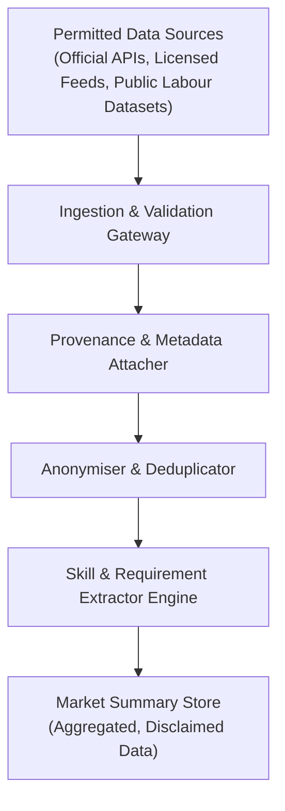

# Market Data Methodology & Job Description Analysis

## 1. Overview and Core Philosophy

SkillGraph provides two distinct, decoupled mechanisms for career readiness evaluation:

1. **Curated Role Profiles (Phase 3 Baseline):**
   Standardised, expert-vetted role profiles representing baseline competencies for modern technology roles. These profiles provide a stable, normative benchmark and do not fluctuate based on transient or idiosyncratic postings.

2. **Empirical Job Description Analysis (Phase 4 User-Supplied):**
   Ad-hoc analysis of specific, user-supplied job descriptions. This analysis directly extracts skills, stated requirements, preferred qualifications, and experience expectations from the text provided by the user.

> [!IMPORTANT]
> **Strict Separation of Evidence:**
> Job description analysis operates strictly on the text provided in the request. The system never infers unstated employer desires, does not inject unmentioned requirements from curated role profiles, and does not claim to represent live market trends without verified source attribution.

---

## 2. Extraction Methodology from Free-Form Text

Extracting structured requirements from unstructured job descriptions presents inherent natural language challenges. SkillGraph uses deterministic, rule-based extraction combined with section segmentation:

### 2.1 Section Segmentation & Requirement Classification

Job descriptions typically distinguish mandatory qualifications from aspirational preferences. SkillGraph identifies structural cues:

* **Required / Minimum Qualifications:**
  * Header cues: `Requirements`, `Qualifications`, `Minimum Qualifications`, `Basic Qualifications`, `Must Have`, `What You'll Need`, `Core Skills`.
  * Inline cues: Sentences containing `must have`, `required`, `minimum of`.
  * Skills extracted from these sections are classified into `required_skills`.

* **Preferred / Bonus Qualifications:**
  * Header cues: `Preferred Qualifications`, `Nice to Have`, `Bonus Points`, `What Gives You an Edge`, `Desired Skills`, `Pluses`.
  * Inline cues: Sentences containing `preferred`, `nice to have`, `bonus if you have`, `ideal candidate has`.
  * Skills extracted from these sections are classified into `preferred_skills`.

* **General / Unclassified Context:**
  * Where headers or inline distinctions are absent, skills are categorized as general `extracted_skills` and evaluated collectively, with appropriate transparency caveats provided to the user.

### 2.2 Skill Detection and Alias Canonicalization

Skill detection utilizes the centralized SkillGraph catalogue (`skill_aliases.json`):
* **Full-Word Boundary Enforcement:** Patterns enforce boundary rules `(?<![A-Za-z0-9_+#])` and `(?![A-Za-z0-9_+#])` to prevent false positives (e.g. bare `C` matching inside `C++` or `C#`, `Java` matching inside `JavaScript`).
* **Punctuation Resilience:** Patterns match skills adjacent to standard document punctuation (e.g., `Python.`, `(FastAPI)`, `PostgreSQL,`).
* **Canonical Mapping:** Surface aliases (e.g. `k8s` → `Kubernetes`, `postgres` → `PostgreSQL`, `pyspark` → `Apache Spark`) map back to canonical skill entities.

### 2.3 Experience & Education Extraction

The extraction engine parses explicit tenure and degree constraints:
* **Tenure Statements:** Matches patterns such as `X+ years of experience in Y`, `X to Y years with Z`, and `at least X years`.
* **Degree Qualifications:** Detects explicit educational baselines (e.g., `Bachelor's in Computer Science or equivalent`, `Master's`, `PhD`).

---

## 3. Metrics and Limitations

### 3.1 Coverage Calculation

$$\text{coverage} = \frac{\text{matched required skills}}{\text{total required skills}} \times 100$$

Where required vs. preferred sections are identifiable, coverage evaluates only mandatory skills. When a job description does not differentiate sections, coverage evaluates all extracted skills:

$$\text{coverage} = \frac{\text{matched skills}}{\text{total extracted skills}} \times 100$$

### 3.2 Technical Limitations of Free-Text Parsing

* **Keyword Absence is Not Incompetence:** A candidate may possess deep expertise in a topic without having explicitly listed the exact keyword on their resume.
* **Keyword Presence is Not Proof of Competence:** Listing a technology on a resume does not guarantee practical proficiency, architectural mastery, or production experience.
* **The "Kitchen Sink" Phenomenon:** Job descriptions frequently list aspirational "wish lists" assembled by committee or recruiters rather than actual operational requisites.
* **Non-Standard Formatting:** Descriptions with non-standard bulleting, complex tables, or unusual terminology may lead to imperfect section boundaries.
* **No Predictive Hiring Probability:** The match score reflects literal text correspondence. It is not an employer hiring score, candidate ranking, or prediction of interview performance.

---

## 4. Architecture for Permitted Market Data Collection

SkillGraph is designed for ethical data handling and compliance. **Unauthorised scraping of job boards, bypassing authentication, or violating robots.txt is strictly prohibited.**

To support future aggregate market summaries, SkillGraph establishes an ingestion contract for permitted data sources:

### 4.1 Permitted Data Channels
1. **Official Partner APIs:** Job boards and ATS platforms providing authorized developer API access (OAuth 2.0 / API key).
2. **Open Public Labour Data:** Official governmental repositories (e.g., U.S. Bureau of Labor Statistics, UK ONS, Eurostat).
3. **Licensed Datasets:** Commercially acquired or open-access curated research datasets.
4. **Direct Employer Submissions:** Job descriptions provided directly by hiring organizations via verified enterprise channels.

### 4.2 Mandatory Market Summary Metadata

Any future aggregated market insight or skill prevalence report must retain the following audit metadata:

| Metadata Field | Type | Description |
| :--- | :--- | :--- |
| `source` | `str` | Name of the authorized API, public dataset, or licensing entity. |
| `collection_date` | `str` | ISO 8601 timestamp of data collection. |
| `geography` | `str` | Geographic boundary (e.g., `US-Remote`, `EU-DE`, `Global`). |
| `sample_size` | `int` | Exact count of unique, deduplicated postings analyzed. |
| `skill_detection_method` | `str` | Exact identifier and version of the extraction engine (e.g., `SkillGraph-Regex-v1.0`). |

> [!CAUTION]
> **Prohibition of Synthetic Market Claims:**
> SkillGraph strictly rejects the fabrication of market data. No synthetic listings, fabricated salary ranges, estimated hiring percentages, or simulated demand trends may ever be generated or presented to users as empirical market statistics.

